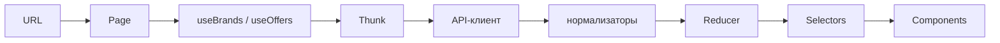

# Подбор автозапчастей

SPA для двухэтапного подбора автозапчастей: по номеру детали сначала находятся производители, затем по номеру и бренду — запрошенная позиция, аналоги, цены и остатки по складам.

Демо: будет добавлено после деплоя.

## Возможности

- Автопоиск по номеру с debounce 500 мс (от 3 символов) или сразу по Enter / кнопке.
- Этап 1: список производителей по `/?number=…`.
- Этап 2: искомая деталь и аналоги на `/offers?number=…&brand=…`.
- Фильтры и сортировка аналогов (текст, «только в наличии», цена / остаток), кнопка «Показать ещё» по 20 позиций.
- Раскрываемый список складов позиции (цена, остаток, дата отгрузки).
- Состояния загрузки, ошибок API, сбоев сети и пустых ответов.
- Адаптивная вёрстка: на ширине менее 768 px таблица превращается в карточки без горизонтального скролла.
- Светлая и тёмная темы (`data-bs-theme`, выбор в шапке).
- Базовая доступность (skip-ссылка, фокус, live-области, клавиатура).
- Превью ссылок (Open Graph / Twitter Card) и фавикон.

## Стек

| Технология | Зачем |
| --- | --- |
| React 19.3 | UI |
| Vite 8.3 | Сборка и dev-сервер |
| Redux 5.0 + redux-thunk 3.1 + react-redux 9.3 | Классический store, асинхронные thunks, подключение к React |
| React Router 7.18 | Маршруты и query-параметры как источник правды |
| Bootswatch Lux 5.3 (Bootstrap CSS) | Тема оформления без JS Bootstrap |
| Vitest 5.1 | Unit- и integration-тесты |
| React Testing Library 16.3 + user-event 14.6 | Тесты поведения UI |
| MSW 3.0 | Мок HTTP в тестах |
| ESLint 10.14 | Линтинг |
| Prettier 3.9 | Форматирование |

## Быстрый старт

Требования: Node.js **20.19+** или **22.12+** (как у Vite 8).

```bash
npm install
cp .env.example .env.local
npm run dev
```

Переменные в `.env.local` (из `.env.example`):

| Переменная | Назначение |
| --- | --- |
| `VITE_API_BASE_URL` | Абсолютный URL API, например `https://api.favorit-parts.ru/hs/hsprice/` |
| `VITE_API_KEY` | Ключ API (`key` в query). Тестовый ключ из документации API: `00000000-0000-0000-0000-000000000001` |
| `VITE_SITE_URL` | Абсолютный origin сайта без слэша на конце; нужен при сборке для Open Graph (`og:image`) |

### npm-скрипты

| Скрипт | Команда | Назначение |
| --- | --- | --- |
| `npm run dev` | `vite` | Dev-сервер |
| `npm run build` | `vite build` | Production-сборка |
| `npm run preview` | `vite preview` | Превью сборки |
| `npm run lint` | `eslint .` | ESLint |
| `npm test` | `vitest run` | Тесты один раз |
| `npm run test:watch` | `vitest` | Тесты в watch-режиме |
| `npm run coverage` | `vitest run --coverage` | Покрытие |
| `npm run format` | `prettier --write src` | Форматирование `src` |
| `npm run check` | `lint` + `test` + `build` | Полная проверка перед сдачей |

## Как это устроено

### Поток данных



### Дерево `src`

```text
src/
  api/                 HTTP-клиент, ApiError, нормализаторы, partsApi
  components/          Общие UI-компоненты (классовые и функциональные)
  features/
    brands/            Этап 1: actionTypes, actions, reducer, selectors
    offers/            Этап 2: actionTypes, actions, reducer, selectors
  hooks/               Данные и UI-логика для функциональных компонентов
  pages/               Тонкие страницы: Home, Offers, 404
  store/               createStore, rootReducer, helpers (STATUS, query)
  styles/app.css       Точечные стили сверх утилит Bootstrap
  test/                unit/, integration/, fixtures, MSW, renderWithProviders
  utils/               Константы, форматы, фильтры/сортировка, тема, маршруты
  App.jsx              Маршруты
  main.jsx             Точка входа
```

### Состояние (Redux)

Формы срезов:

- **brands:** `{ status, query: { number } | null, items, error }`
- **offers:** `{ status, query: { number, brand } | null, requested, analogues, error }`

`status`: `'idle' | 'loading' | 'succeeded' | 'failed'`.

Защита от устаревших ответов: в REQUEST / SUCCESS / FAILURE передаётся `query`; редьюсер применяет SUCCESS/FAILURE только если `isSameQuery(action.query, state.query)`. Thunks не стартуют повторный запрос при том же `query` и статусе `loading` или `succeeded` (дедупликация / кэш до перезагрузки страницы).

Классический Redux без Toolkit и без фабрик редьюсеров: явные строковые типы, `switch` и spread — проще читать и отлаживать на небольшом объёме (KISS).

### API-слой

В браузере запросы идут напрямую на `VITE_API_BASE_URL` (`https://api.favorit-parts.ru/hs/hsprice/`). API отдаёт CORS `Access-Control-Allow-Origin: *`, отдельный proxy не нужен.

`ApiError` различает виды: `network`, `http`, `parse`, `api` (тело `{ error: … }` даже при HTTP 200).

Нормализация в `src/api/normalizers.js`:

- пустая структура «не найдено» (`goodsID` нулей / пустые brand·name·number) → пустой результат;
- цена позиции — минимум по складам с остатком (`warehouses[].price`), не `Item.price`;
- остаток позиции — `count` (`totalStock`).

### Классовые и функциональные компоненты

В `src/components` **6 классовых из 18** компонентов (**33%**), остальное — функциональные (включая иконки темы).

| Компонент | Тип | Почему |
| --- | --- | --- |
| `ErrorBoundary` | класс | `getDerivedStateFromError` / `componentDidCatch` |
| `SearchForm` | класс | Локальный ввод + `componentDidUpdate` для синхронизации с URL |
| `BrandList` | класс | Список брендов через `connect` и селекторы, без хуков |
| `OffersTable` | класс | Презентационная таблица без локальной логики хуков |
| `OffersToolbar` | класс | Панель фильтров с обработчиками-полями класса |
| `PartRow` | класс | Локальный `expanded` для складов |
| `AsyncView` | функция | Единый каркас loading / error / empty / success |
| `EmptyState` | функция | Пустой результат |
| `ErrorAlert` | функция | Сообщение об ошибке + повтор |
| `Layout` | функция | Шапка, skip-ссылка, фокус на `main` |
| `Loader` | функция | Индикатор загрузки (`role="status"`) |
| `OffersResults` | функция | Связка toolbar + таблицы + «Показать ещё» |
| `StockBadge` | функция | Бейдж остатка |
| `ThemeToggle` | функция | Выбор темы |
| `WarehouseList` | функция | Список складов |
| `SunIcon` / `MoonIcon` / `CircleHalfIcon` | функция | Иконки переключателя темы |

Кастомные хуки:

- `useBrands` — загрузка и статус производителей по номеру из URL
- `useOffers` — загрузка искомой детали и аналогов по number + brand
- `useOffersView` — локальные фильтры, сортировка и пагинация аналогов
- `useDebouncedCallback` — отложенный вызов (автопоиск)
- `useDocumentTitle` — `document.title` страницы
- `useTheme` — светлая / тёмная тема и `data-bs-theme`
- `useDropdown` — открытие/закрытие меню (клик снаружи, Escape)

### Ключевые решения

- **URL — источник правды:** `/?number=…` и `/offers?number=…&brand=…`; страницы тонкие, данные тянут хуки.
- **Debounce и мин. длина** (`SEARCH_DEBOUNCE_MS = 500`, `MIN_SEARCH_LENGTH = 3`) — из‑за квоты API.
- **Пагинация и фильтры локально** (не в Redux) — ответы этапа 2 могут содержать 700+ аналогов.
- **Адаптивная таблица** через CSS и `data-label`, без горизонтального скролла.
- **Тема** через `data-bs-theme` на `<html>`, сохранение в `localStorage`.

## Тесты

```bash
npm test              # 50 тестов
npm run test:watch
npm run coverage
```

Структура `src/test`:

- `unit/` — редьюсеры, нормализаторы, утилиты, отдельные компоненты и хуки
- `integration/` — API-клиент, thunks, страницы, сквозной сценарий
- хелперы: `setup.js`, `server.js`, `handlers.js`, `renderWithProviders.jsx`
- `fixtures/` — ответы API для этапа 1 и 2

Что проверяют файлы:

| Файл | Суть |
| --- | --- |
| `unit/brandsReducer.test.js` | Переходы статуса и отбрасывание чужого `query` |
| `unit/normalizers.test.js` | Нормализация брендов/предложений и «не найдено» |
| `unit/partsView.test.js` | Фильтрация и сортировка аналогов |
| `unit/SearchForm.test.jsx` | Submit, trim, disabled при пустом вводе |
| `unit/ErrorBoundary.test.jsx` | Перехват ошибки рендера и восстановление |
| `unit/useDebouncedCallback.test.js` | Схлопывание быстрых вызовов и cancel |
| `unit/useDocumentTitle.test.js` | Формат заголовка вкладки |
| `integration/apiClient.test.js` | Успех, `ApiError` (api/http/network) через MSW |
| `integration/brandsThunks.test.js` | fetchBrands: успех, пусто, ошибки, дедуп, race |
| `integration/HomePage.test.jsx` | Debounce-поиск и смена номера в URL |
| `integration/appFlow.test.jsx` | Поиск → бренд → предложения → назад, a11y-фокус |

Покрыты ключевые сценарии, а не весь код. Отчёт покрытия: `npm run coverage`.

## Доступность

- Skip-ссылка «К содержимому» на `#main-content`
- Фокус на `<main>` при смене маршрута
- `document.title` для страниц (`useDocumentTitle`)
- Live-области (`aria-live`) для статусов и счётчиков
- Ориентиры: `header` / `nav` / `main`, `role="search"`, `role="status"` / `role="alert"`
- Клавиатура: формы, ссылки-бренды, раскрытие складов, меню темы (Escape)

## Превью ссылок и иконки

В `index.html` заданы Open Graph и Twitter Card; абсолютный URL картинки собирается из `VITE_SITE_URL` при сборке. Фавикон: чёрный `public/favicon.svg` и PNG-запас.

Исходники в `design/` (`og-image.svg`, `apple-touch-icon.svg`). Пересборка PNG:

```bash
npm i --no-save sharp && node scripts/generate-icons.mjs
```


## Ограничения и допущения

- `VITE_API_KEY` попадает в клиентский бандл — допустимо для тестового ключа; для продакшена ключ лучше не светить на клиенте.
- Кэш ответов в Redux живёт до перезагрузки страницы.
- У API есть квота запросов — отсюда debounce и минимальная длина автопоиска.
- Фавикон чёрный (на тёмной вкладке браузера может сливаться).
- Язык интерфейса — русский; валюта — рубли (`Intl.NumberFormat` с локалью `ru-RU`).

Полное ТЗ и заметки по API: [docs/SPEC.md](docs/SPEC.md).
